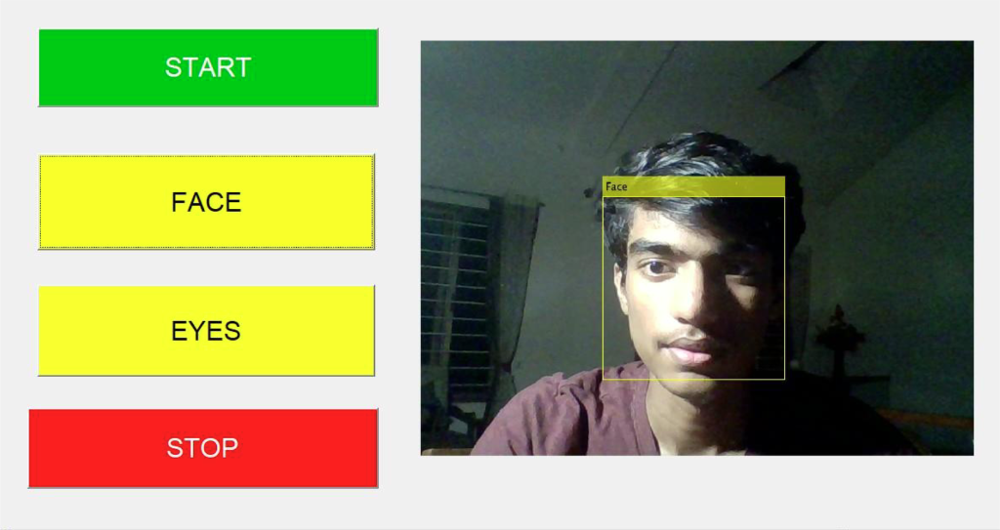
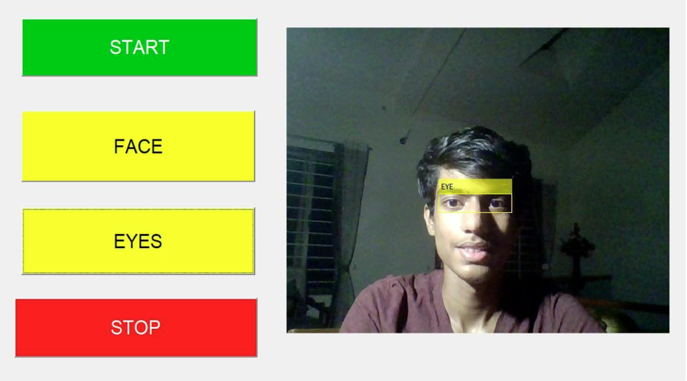

# Face-And-Eyes-Recognition-In-Matlab

A small MATLAB GUI that detects a face or the eyes in the live webcam feed and draws a box around them.

Detection uses the Viola-Jones method through `vision.CascadeObjectDetector` from the Computer Vision Toolbox. Nothing is trained here, it uses the cascade models that come with MATLAB:

- Face uses the default frontal face model.
- Eyes uses the `EyePairBig` model, which finds both eyes together as one box.

## Files

- `face_recognition.m` - GUI code and button callbacks
- `face_recognition.fig` - GUI layout made in GUIDE
- `images/` - screenshots of the GUI running

## Requirements

- MATLAB with the Computer Vision Toolbox and the Image Acquisition Toolbox
- Image Acquisition Toolbox Support Package for OS Generic Video Interface (the `winvideo` adaptor, so Windows only)
- A webcam

## How to run

Keep both files in the same folder, open it in MATLAB and run:

```matlab
face_recognition
```

- **START** opens the first webcam and shows the live video.
- **FACE** draws a box around faces.
- **EYES** draws a box around the eyes.
- **STOP** stops the camera.

You can switch between FACE and EYES while the camera is running. The camera uses its default format. If you have more than one webcam, change the device number in `videoinput('winvideo', 1)`.

## Screenshots




